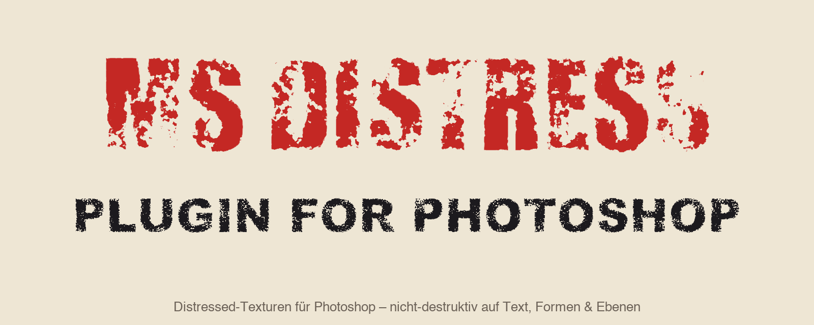
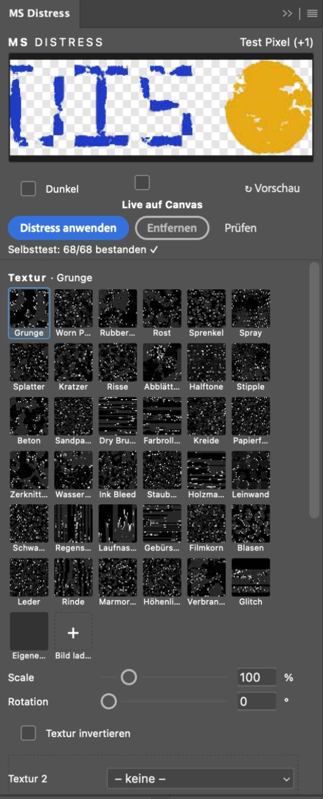
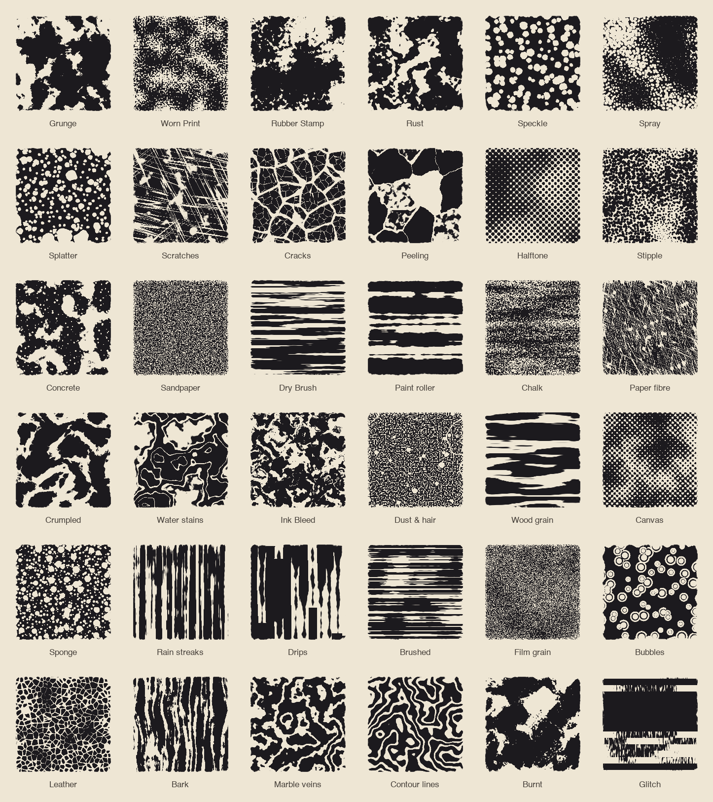
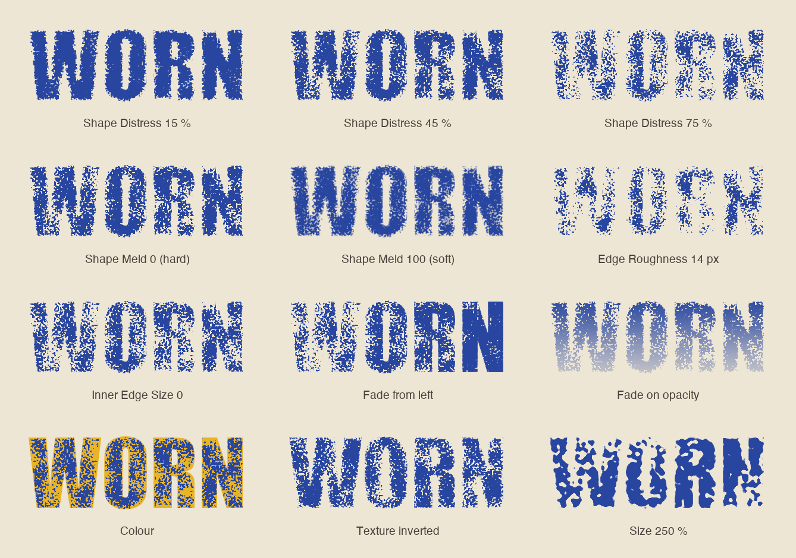
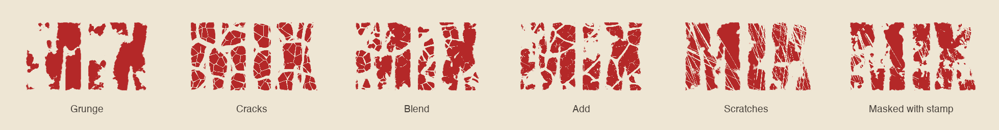

<p align="center">
  
</p>

<p align="center">
  <b>Distressed, grunge and print looks for Photoshop – one click, non-destructive, on text, shapes and any layer.</b><br>
  <sub>Photoshop 2023 (24.2) or newer · UXP panel · macOS & Windows</sub><br>
  <sub>Free Photoshop tools by <b>Morgenstern</b> · <b>Morgenstern Distress</b> · <a href="https://github.com/M0rgenst3rn/ms-printer">Morgenstern Printer</a> · <a href="https://github.com/M0rgenst3rn/ms-render">Morgenstern Render</a> · <a href="https://github.com/M0rgenst3rn/ms-phase">Morgenstern Phase</a> · <a href="https://github.com/M0rgenst3rn/ms-glow">Morgenstern Glow</a> · <a href="https://github.com/M0rgenst3rn/ms-gradients">Morgenstern Gradients</a></sub>
</p>

---

## What is Morgenstern Distress?

Morgenstern Distress is a panel plugin for Adobe Photoshop. It gives lettering, logos, shapes and image layers
a worn look, like a rubber stamp, screen print, rust, cracks or scratches. You set the look with a few sliders
and see it right away in the preview or live on the canvas.

The effect is created as a **layer mask**. So your text stays editable, and ⌘Z or "Remove" undoes everything.

<table>
<tr>
<td width="38%" valign="top"></td>
<td valign="top">

### Highlights

- **36 built-in textures**: grunge, rubber stamp, rust, cracks, scratches, halftone, chalk, paint roller, drips, leather, glitch and many more
- **Your own images as textures**: load PNG, JPG, TIF or PSD. They are stored permanently as tiles
- **A layer as texture**: any layer in the document can serve as the texture
- **Combine two textures**: blend, add or mask
- **Live**: slider changes land directly on the canvas, as *one* history step
- **Shape Color**: worn areas are tinted in a colour of your choice
- **Fade**: the effect fades, e.g. from the top, radially, as a frame or in clouds – on the distress or the opacity
- **Several layers at once**, optionally with its own variation per layer
- **11 looks** plus your own presets
- **A tidy panel**: collapsible sections, its own colour palette, the essentials on top, everything else in Fine-tuning
- **Self-test & Verify**: the plugin checks whether the canvas really matches the settings

</td>
</tr>
</table>

## Textures

All 36 textures are procedural, i.e. generated mathematically. So they stay sharp at any size and have no
visible repetition. **Seed** (Shuffle) gives endless variants of every texture.

<p align="center"></p>

## The sliders

<p align="center"></p>

| Slider | What it does |
|---|---|
| **Size / Angle** | Size (10–500 %) and rotation of the texture |
| **Shape Distress** | How strongly the edges of the shape wear away |
| **Shape Meld** | Transition: 0 = hard stamp edges, 100 = softly blended |
| **Edge Roughness** | Frayed, nibbled outer edge (in pixels) |
| **Inner Distress** | How strongly the inside of the shape wears away |
| **Inner Edge Size** | Width of the edge zone where *Shape Distress* applies. Beyond it *Inner Distress* applies |
| **Fade: Amount / Direction** | Lets the effect fade: from the top, bottom, left, right, diagonally, radially, as a frame or in clouds |
| **Fade affects** | Distress, opacity or both |
| **Shape Color** | Tints worn areas, on its own freely editable layer |
| **Invert texture** | Swaps which areas wear away first |
| **Seed** | A new variant of the same setting (Shuffle) |

The textures are equalised internally. **So 40 % distress means roughly 40 % worn-away area with every
texture.** When you switch textures, the strength stays the same.

## Combining textures

With **Second** above the textures you lay a second texture over the first, with its own mix and size:

<p align="center"></p>

- **Blend**: both patterns flow into each other
- **Add**: it wears away where *either* texture wears away
- **Mask**: it only wears away where *both* do, e.g. scratches only inside the stamp spots

## Installation

### macOS (recommended)

1. Download the repository (green button **Code → Download ZIP**) and unzip it
2. Quit Photoshop
3. Run this in Terminal inside the unzipped folder:
   ```bash
   bash install-mac.sh
   ```
4. Start Photoshop → **Plugins › MS Distress**

The script packs the plugin and installs it with Adobe's own plugin installer. Creative Cloud then knows it
and won't remove it again.

### Alternative: UXP Developer Tool (macOS & Windows)

1. Install "UXP Developer Tools" from the Creative Cloud app
2. In Photoshop, turn on **Developer Mode** under *Settings › Plugins*
3. In the UXP Developer Tool choose **Add Plugin**, then `distress/manifest.json` → **Load**

## How to use it

1. Select one or more layers (text, shape, smart object, pixels)
2. Click a texture and set the sliders. The preview at the top shows the result right away
3. Click **Apply**, or turn on **Live**
4. Done. **Remove** takes the mask and colour layer away again

**Tips**
- Strokes of shape layers are not worn away. For a clean look set the stroke to "none"
- Good sources for your own image textures are black-and-white grunge, paper and concrete scans. Dark areas wear away
- **Verify** shows whether the canvas matches the current settings

## Project structure

```
distress/            The plugin (loaded into Photoshop as is)
  manifest.json      Plugin description for Photoshop
  index.html         Panel UI
  ms-ui.js/.css      Shared Morgenstern controls and design
  main.js            Photoshop side (masks, layers, Live mode, self-test)
  core.js            Texture engine, plain JavaScript without Photoshop dependencies
install-mac.sh       Packs the plugin (.ccx) and installs it
tools/               Test renderer, README image generator, browser preview of the panel
docs/images/         Screenshots and example images
```

### Development

The engine can be tested without Photoshop:

```bash
node tools/render-test.js test.png
```

Rebuild the images of this README (needs Python with Pillow):

```bash
python3 tools/make-showcase.py
```

## Found a bug? Got an idea?

Get in touch! The easiest way is **[Issues](https://github.com/M0rgenst3rn/ms-distress/issues)** here on GitHub:
click **New issue** and briefly describe what happened. Your Photoshop version, operating system and a
screenshot help a lot. All you need is a free GitHub account. Suggestions and feature requests are just as
welcome.

## License

[MIT with the Commons Clause](LICENSE): the plugin is free. You may use it for any work, including paid
client work, and you may read, change and share the code.
You may not sell the plugin or a version of it (changed or not), or charge for a product or service whose
value comes mainly from it.
Everything you create with it (designs, images, prints) is yours, and you may sell it.
The license notice stays in copies.

Adobe and Photoshop are trademarks of Adobe Inc. This project is independent and not affiliated with Adobe.

---

<p align="center"><sub>Morgenstern Distress<br>
Made by Linus Leinberger</sub></p>
