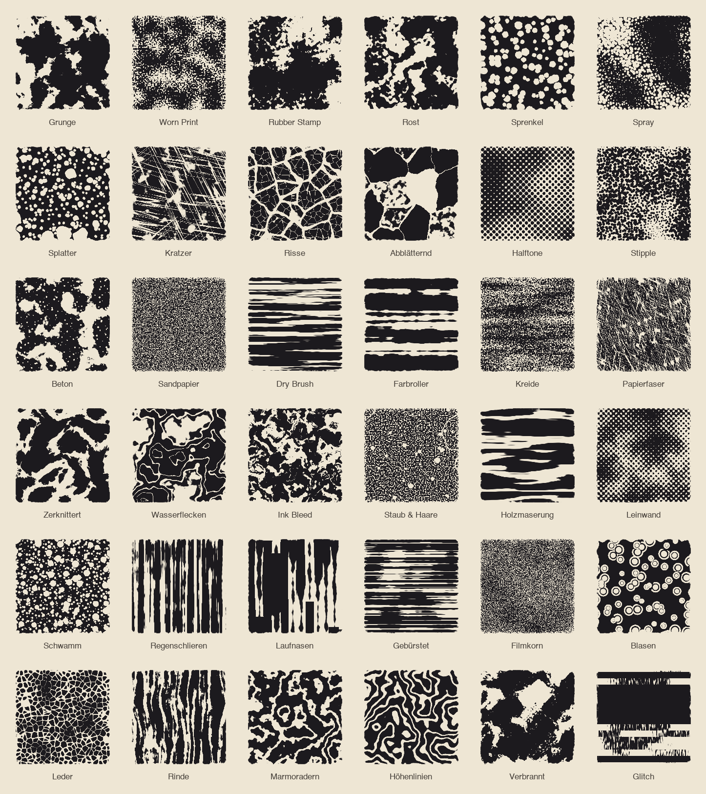
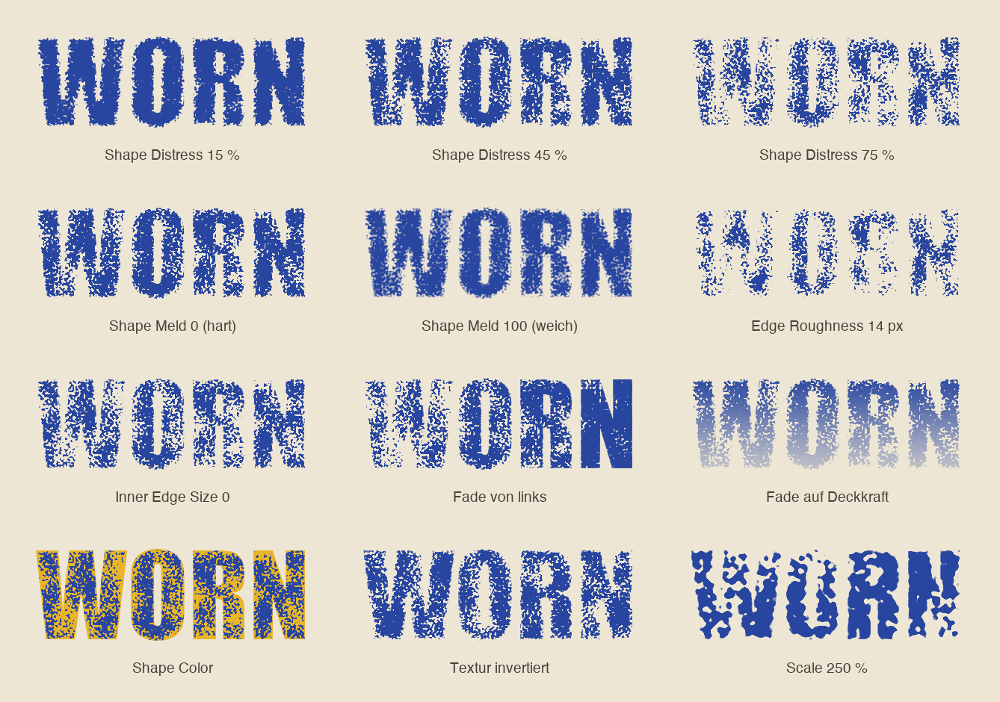

<p align="center">
  
</p>

<p align="center">
  <b>Distressed-, Grunge- und Print-Looks für Photoshop – mit einem Klick, nicht-destruktiv, auf Text, Formen und jeder Ebene.</b><br>
  <sub>Photoshop 2023 (24.2) oder neuer · UXP-Panel · macOS & Windows</sub><br>
  <sub><b>MS</b> steht für <b>Morgenstern</b>: freie Photoshop-Tools · <b>MS Distress</b> · <a href="https://github.com/M0rgenst3rn/ms-printer">MS Printer</a> · <a href="https://github.com/M0rgenst3rn/ms-render">MS Render</a> · <a href="https://github.com/M0rgenst3rn/ms-phase">MS Phase</a></sub>
</p>

---

## Was ist MS Distress?

MS Distress ist ein Panel-Plugin für Adobe Photoshop. Es gibt Schriften, Logos, Formen und Bildebenen einen
abgenutzten Look, etwa Stempel, Siebdruck, Rost, Risse oder Kratzer. Den Look stellst du mit ein paar Reglern ein
und siehst ihn sofort in der Vorschau oder live auf der Arbeitsfläche.

Der Effekt wird als **Ebenenmaske** angelegt. Dein Text bleibt also editierbar, und mit ⌘Z oder „Entfernen“
ist alles wieder rückgängig.

<table>
<tr>
<td width="38%" valign="top"></td>
<td valign="top">

### Highlights

- **36 eingebaute Texturen**: Grunge, Rubber Stamp, Rost, Risse, Kratzer, Halftone, Kreide, Farbroller, Laufnasen, Leder, Glitch und viele mehr
- **Eigene Bilder als Texturen**: PNG, JPG, TIF oder PSD laden. Sie werden dauerhaft als Kachel gespeichert
- **Eine Ebene als Textur**: Jede Ebene im Dokument kann als Textur dienen
- **Zwei Texturen kombinieren**: Überblenden, Addieren oder Maskieren
- **Live auf Canvas**: Änderungen an den Reglern landen direkt auf der Arbeitsfläche, als *ein* Protokollschritt
- **Shape Color**: Abgetragene Stellen werden in einer Farbe deiner Wahl eingefärbt
- **Fade**: Der Effekt verläuft, zum Beispiel von oben, radial, als Rahmen oder in Wolken, wahlweise auf Distress oder Deckkraft
- **Mehrere Ebenen gleichzeitig**, auf Wunsch mit eigener Variation pro Ebene
- **11 Presets** plus eigene Presets speichern
- **Selbsttest & Prüfen**: Das Plugin kontrolliert, ob der Canvas wirklich den Einstellungen entspricht

</td>
</tr>
</table>

## Texturen

Alle 36 Texturen sind prozedural, also mathematisch erzeugt. Darum werden sie in jeder Größe scharf und haben
keine sichtbaren Wiederholungen. Über **Random Seed** bekommst du von jeder Textur unendlich viele Varianten.

<p align="center"></p>

## Die Regler

<p align="center"></p>

| Regler | Was er macht |
|---|---|
| **Scale / Rotation** | Größe (10–500 %) und Drehung der Textur |
| **Shape Distress** | Wie stark die Kanten der Form abgetragen werden |
| **Shape Meld** | Übergang: 0 = harte Stempelkanten, 100 = weich verschmolzen |
| **Edge Roughness** | Fransige, angeknabberte Außenkante (in Pixeln) |
| **Inner Distress** | Wie stark das Innere der Form abgetragen wird |
| **Inner Edge Size** | Breite der Kantenzone, in der *Shape Distress* gilt. Dahinter gilt *Inner Distress* |
| **Fade Amount / Style** | Lässt den Effekt verlaufen: von oben, unten, links, rechts, diagonal, radial, als Rahmen oder in Wolken |
| **Fade wirkt auf** | Distress, Deckkraft oder beides |
| **Shape Color** | Färbt abgetragene Stellen ein, auf einer eigenen, frei editierbaren Ebene |
| **Textur invertieren** | Vertauscht, welche Bereiche zuerst abgetragen werden |
| **Random Seed** | Neue Variante derselben Einstellung (🎲 Würfeln) |

Die Texturen werden intern gleichverteilt. **40 % Distress bedeuten deshalb bei jeder Textur ungefähr 40 %
abgetragene Fläche.** Wechselst du die Textur, bleibt die Stärke gleich.

## Texturen kombinieren

Unter **Textur 2** legst du eine zweite Textur über die erste, mit eigenem Mix und eigener Scale:

<p align="center"></p>

- **Überblenden**: Beide Muster gehen ineinander über
- **Addieren**: Abgetragen wird, wo *eine* der beiden Texturen abträgt
- **Maskieren**: Abgetragen wird nur, wo *beide* abtragen, zum Beispiel Kratzer nur in den Stempel-Flecken

## Installation

### macOS (empfohlen)

1. Repository herunterladen (grüner Button **Code → Download ZIP**) und entpacken
2. Photoshop beenden
3. Im Terminal im entpackten Ordner ausführen:
   ```bash
   bash install-mac.sh
   ```
4. Photoshop starten → **Fenster › Zusatzmodule (Plugins) › MS Distress**

Das Script packt das Plugin und installiert es über Adobes eigenen Plugin-Installer. Creative Cloud kennt es
danach und entfernt es nicht wieder.

### Alternative: UXP Developer Tool (macOS & Windows)

1. „UXP Developer Tools“ über die Creative-Cloud-App installieren
2. In Photoshop unter *Einstellungen › Zusatzmodule* den **Entwicklermodus** aktivieren
3. Im UXP Developer Tool **Add Plugin** wählen, dann `distress/manifest.json` → **Load**

## So benutzt du es

1. Eine oder mehrere Ebenen auswählen (Text, Form, Smartobjekt, Pixel)
2. Eine Textur anklicken und die Regler einstellen. Die Vorschau oben zeigt das Ergebnis sofort
3. **Distress anwenden** klicken, oder **Live auf Canvas** einschalten
4. Fertig. Mit **Entfernen** nimmst du Maske und Farbebene wieder weg

**Tipps**
- Konturen (Stroke) von Formebenen werden nicht mit abgetragen. Für einen sauberen Look die Kontur auf „keine“ stellen
- Gute Quellen für eigene Bild-Texturen sind Grunge-, Papier- und Betonscans in Schwarzweiß. Dunkle Bereiche tragen ab
- Mit **Prüfen** siehst du, ob der Canvas den aktuellen Einstellungen entspricht

## Projektstruktur

```
distress/          Das Plugin (wird so in Photoshop geladen)
  manifest.json      Plugin-Beschreibung für Photoshop
  index.html         Panel-Oberfläche
  main.js            Photoshop-Anbindung (Masken, Ebenen, Live-Modus, Selbsttest)
  core.js            Textur-Engine, reines JavaScript ohne Photoshop-Abhängigkeit
install-mac.sh       Packt das Plugin (.ccx) und installiert es
tools/               Test-Renderer und Generator für die Bilder in dieser README
docs/images/         Screenshots und Beispielbilder
```

### Entwicklung

Die Engine lässt sich ohne Photoshop testen:

```bash
node tools/render-test.js test.png
```

Die Bilder dieser README neu erzeugen (braucht Python mit Pillow):

```bash
python3 tools/make-showcase.py
```

## Fehler gefunden? Ideen?

Melde dich gern! Am einfachsten über **[Issues](https://github.com/M0rgenst3rn/ms-distress/issues)** hier auf GitHub:
**New issue** klicken und kurz beschreiben, was passiert ist. Hilfreich sind Photoshop-Version, Betriebssystem
und gern ein Screenshot. Dafür brauchst du nur ein kostenloses GitHub-Konto. Verbesserungsvorschläge und
Wünsche für neue Funktionen sind genauso willkommen.

## Lizenz

[MIT](LICENSE): Du darfst den Code frei ansehen, verändern, weitergeben und auch kommerziell nutzen.
Einzige Bedingung: Der Lizenzhinweis bleibt in Kopien enthalten.

Adobe und Photoshop sind Marken von Adobe Inc. Dieses Projekt ist unabhängig und steht in keiner
Verbindung zu Adobe.

---

<p align="center"><sub>MS Distress · ein Tool von <b>Morgenstern</b><br>
Entwickelt von Linus Leinberger</sub></p>
